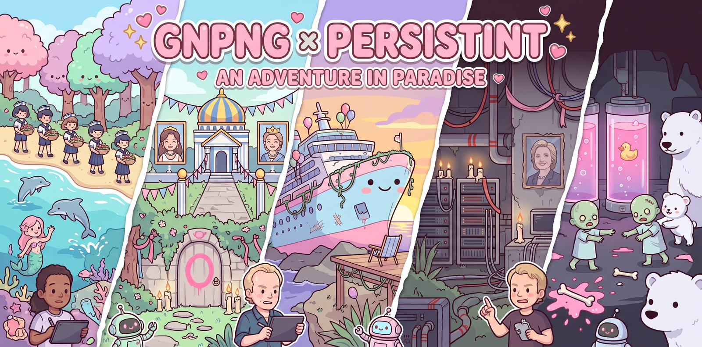
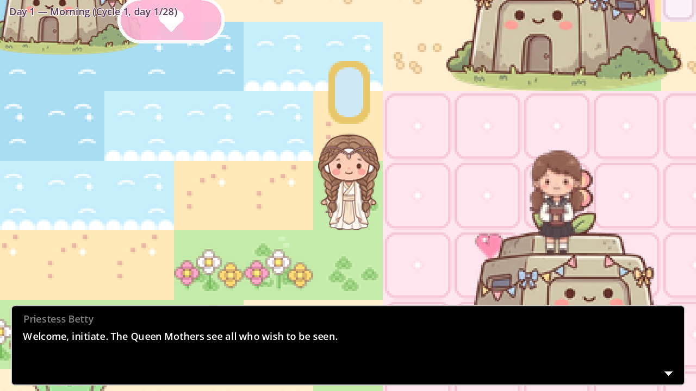
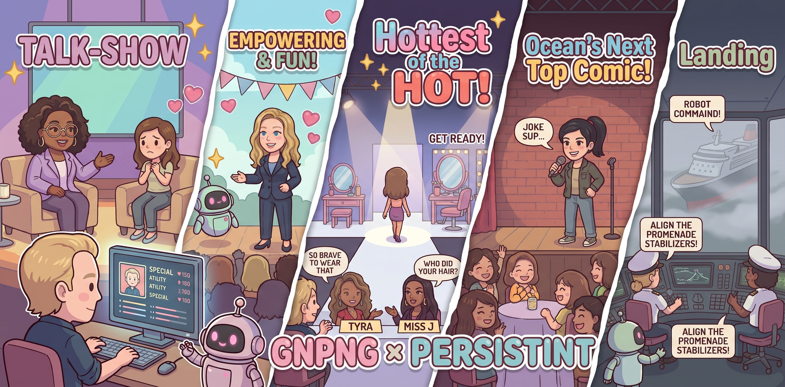
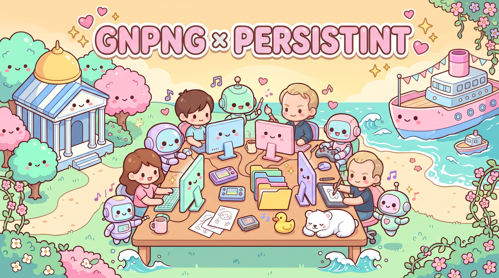

# PERSISTINT

***a lovely little island. everyone contributes. everyone.***

**PERSISTINT is a companion game to *Persistint*, an in-development novel by Brett Whitty, coming
soon from [GNPNG](https://gnpng.org), an independent Canadian press.**

[](https://www.youtube.com/watch?v=8GxFjrDAJf4)

*"Persistint" — a novel by Brett Whitty, coming soon from GNPNG (book trailer, 2:11)*

**Status: v0.3.8 — zeroth release (playable vertical slice, placeholder art in places).**

PERSISTINT is a free companion game: a small 2D game
made in Godot 4. It wraps social control in the cutest possible packaging, so
that players, and girls and women above all, can recognize it, name it and feel comfortable
criticizing it, at school, at work or online. The cuteness is the weapon.

## The premise

The game moves between three worlds. In each one the player does the same things: dresses up,
makes things, talks to people, goes places. Only the social framing changes, and that contrast is
the lesson.

| World | Framing | What it is like |
|---|---|---|
| **The tropical Florida Keys** | Innocent play | A Toca World / Animal Crossing sandbox with gardening, crafting, dolphins, friendly crabs and seagulls, aquarium-show mermaids and a pony stable. No scoring, and nothing can be done wrong. |
| **The Cruise** (flashbacks and a later chapter) | Judged performance | A feminist-themed celebrity cruise before the wreck. WarioWare-style mini-games hosted by real celebrities, where passengers are made over, judged and "empowered". |
| **Little St. Piere Island** | Ritualized control | Long after the wreck, the ship and an old colony bunker are sacred ruins. A Covenant of Mothers and Priestesses runs daily life by the 28-day Calendar of Blood, and everyone contributes. |

The same paper-doll dress-up is kind play in tropical Florida, a judged makeover on the cruise and part of
the ritual on the island. After a manipulative moment comes **Name It**: the player picks out the
hook hidden in a compliment and names the tactic (negging, concern-trolling, in-group
gatekeeping). Named tactics go into a journal of Forbidden Knowledge.

There is **no combat** anywhere. Influence, not violence.

World backstory and novel world-building material live in `dev/` (encrypted, author's design
notes).

## Screenshots

| | |
|---|---|
|  |  |
| The village on Little St. Piere Island | The paper-doll wardrobe |
|  |  |
| Ruins of Utopia: the sideways Promenade Deck | The Landing: panic on the bridge (placeholder UI) |
|  |  |
| Hottest of the HOT: the get-ready chain (placeholder UI) | The title screen |

Much of the art is still placeholder (see [Asset pipeline](#asset-pipeline)).

## What's playable now

This is an early build under active development. Everything listed below exists in `project/`;
the headless tests in `project/tests/` exercise most of it.

### Little St. Piere Island

| Feature | Status |
|---|---|
| Village and Temple maps, click to walk, NPC barks that react to world state | Playable |
| Four Covenant NPCs (Initiate, Priestess, Drone, Barren) and the branching quest "The Offering" | Playable |
| Paper-doll wardrobe (hair, dress, accessory), kept in the save | Playable |
| Ritual puzzle in the Temple | Playable |
| Calendar of Blood: day phases, 28-day cycles and the Festival of the Fourteenth, which change what NPCs say | Playable |
| Ruins of Utopia: six rooms, from the wrecked ship down into the bunker and its clone lab, with 14 pieces of Forbidden Knowledge to recover | Playable |
| Journal of Forbidden Knowledge (J): recovered pieces, named tactics, and the cruise flashbacks they unlock, each played from the journal | Playable |
| Name It | Built; its moments are waiting on the author's answers, so none appear in the game yet |


*Under the ruins: the old colony bunker and its clone lab.*

### The tropical Florida Keys

Reached through the village's exit to the tropical beach.

| Feature | Status |
|---|---|
| Beach with dolphins, crabs, seagulls and shells to collect | Playable |
| Garden (plants grow with the days) and craft bench (some crafted pieces can be worn on the paper doll) | Playable |
| Aquarium with mermaids | Playable |
| Pony stable: groom (a makeover for ponies), ride (faster click-to-walk, H to get off), and raise foals whose coat, mane and spots mix from both parents | Playable |
| Art | Mostly placeholder |

### The Cruise



There are two ways aboard. Leaving the island at the end of its chapter shows a time-jump card and
starts the cruise chapter, with a new character, at The Interview. Separately, flashbacks to The
Landing, Hottest of the HOT and America's Next Top Comic each unlock when two particular pieces of
Forbidden Knowledge have been found in the ruins, and are played from the journal. A flashback is
played as a separate cruise passenger; afterwards the island character, and the spot the player
left from, come back. There is no cruise hub map yet.

| Mini-game | Status |
|---|---|
| **The Interview**: Oprah Winfrey interviews you and your answers set your stats (character creation as a talk show) | Playable |
| **The Landing**: Spaceteam-style panic on the bridge as Cap'n Kate tries not to crash a dead ship, with Among Us-flavored crew tasks | Playable |
| **Hottest of the HOT**: Tyra Banks's judging show, with Day of the Tentacle-style get-ready chains across the ship, introduced by Chelsea Clinton | Playable |
| **America's Next Top Comic**: introduced by Chelsea Clinton, Sarah Silverman hosts a stand-up contest built like Monkey Island's insult sword fighting, and the player is the contestant. Each turn the player picks a setup, then a punchline, from a shuffled pool of verified real jokes by Amy Schumer, Sarah Silverman and Hannah Gadsby, so the pairings are horrible and the audience laughs riotously anyway. A few lines in the pool are not the comics' own; telling one gets boos, and the judges dock points for stealing jokes from Amy Schumer. When the setups run out the set ends; there is no winning | Playable |
| Chapter end: leaving the island shows a full-screen time-jump card, then the cruise chapter starts with a fresh character | Playable |

### Controls

| Input | Action |
|---|---|
| Left click | Walk; click people and things to interact |
| P | Wardrobe |
| J | Journal |
| H | Get off a pony while riding |
| Click or any key | Continue past chapter and flashback cards |

There is no keyboard-only or gamepad control yet.

### Planned

What is left before a public release (menus, audio settings, accessibility, a credits screen,
final art, builds, licensing and more) is tracked in the project issue tracker. Longer term, a
social-influence "god-game" is a stretch goal.

## Getting started

You need **Godot 4.6** (standard build, not .NET). The project targets 4.6 with the GL
Compatibility renderer and is tested with 4.6.3.

```bash
git clone <this repository's URL>
cd <the cloned folder>
godot --path project            # run the game
godot --editor --path project   # or open it in the editor
```

You can also start Godot, choose **Import** and select `project/project.godot`. The game opens on
the title menu.

The game saves to `user://save.json`, in Godot's per-user data folder for "Persistint".

### Exporting

`project/export_presets.cfg` has one preset, **Web** (HTML5), which writes to `exports/web/`.
Install the Godot 4.6 export templates, then run:

```bash
godot --headless --path project --export-release "Web" ../exports/web/index.html
```

There are no desktop presets yet. `tools/deploy_web.sh` and `infra/` are the author's own
hosting scripts and are not needed to play or build.

## Running the tests

The tests are Godot scripts run headless, one at a time. Import the project once first, since a
fresh clone has no `.godot/` cache:

```bash
godot --headless --path project --import

godot --headless --path project -s tests/verify_slice.gd
godot --headless --path project -s tests/test_florida.gd
# ...and the same for each tests/test_*.gd
```

To run them all (imports first, prints one line per test, exits non-zero if any fails):

```bash
tools/run_tests.sh                 # every test
tools/run_tests.sh test_save       # just some; --no-import skips the import
```

The tests use their own save and settings files, so they never touch your own progress or volume
levels.

Each script prints `RESULT: PASS` or lists its failures. Most tests back up your real
`user://save.json` and restore it afterwards; `test_landing_crew.gd` does not yet, so back up your
save before running it. There is no single runner script or CI yet.

Opening or importing the project in the editor can rewrite `project/project.godot` (sections
reordered, some settings dropped), so check `git diff` before committing.

`project/tools/screenshot_scenes.gd` saves a screenshot of each main scene. It needs a display, so
run it without `--headless`:

```bash
godot --path project -s tools/screenshot_scenes.gd -- <out_dir> [prefix]
```

## Repository layout

| Path | Contents |
|---|---|
| `project/` | The Godot project: `scenes/`, `scripts/` (autoloads, maps, mini-games, ruins, Florida, chapters, UI), `data/` (game content as JSON), `dialogue/` (Dialogue Manager files), `assets/`, `audio/`, `themes/`, `tests/`, `tools/`, `addons/` |
| `dev/` | `dev/` (encrypted, author's design notes): world backstory and novel world-building material |
| `docs/` | The promo site plan, the author's banner images and the screenshots above |
| `prompts/` | One generator prompt per asset (image, video, music) |
| `tools/` | Python, shell and GDScript tools: island map building, sprite cutting, placeholder art, prompt checks, asset rendering and syncing, voice clips, quote checks |
| `sops/` | Reusable standard operating procedures written while making this game |
| `art/` | Canon reference art, island map reference data with its sources, and the folder for voice reference clips (clips not committed) |
| `infra/` | Web server config for the author's hosting |

## Asset pipeline

- **Style bible.** The author's style bible is the
  single reference for every generated asset: kawaii pixel art over something unsettling, a master
  palette, per-area identity and vocabulary rules.
- **One prompt per asset.** Each file under `prompts/` names its asset, the generator (Gemini
  image, Veo video or Lyria music) and where the result goes in the game. Prompts are compiled
  from the bible ahead of time so they can be pasted into a generator as they are.
  `python3 tools/check_prompts.py` checks them.
- **Rendering.** `tools/render_all_assets.py` renders prompts through the Gemini API (`--status`,
  `--export-queue`, `--type ...`). A browser-driven renderer for the Gemini web app is in
  progress in [tools/web_render/](tools/web_render/), the [gnomatix/web-render](https://gitea.gnomatix.com/gnomatix/web-render) engine as a submodule (`git submodule update --init` after cloning; project side: `web-render.config.json`). `tools/sync_rendered_assets.py` copies rendered files into `project/` (converting video
  to Godot's `.ogv`) and lists what is still missing. See [prompts/README.md](prompts/README.md).
- **Placeholders.** Until rendered art arrives, `tools/gen_placeholder_art.sh` (ImageMagick) and
  the generator scripts in `tools/` make placeholder tiles and sprites.
- **Voices.** Spoken lines are pre-rendered with Coqui XTTS v2 (`node tools/export_voice_lines.mjs`, then
  `tools/generate_voice_clips.py`). `project/data/voices.json` gives each speaker either a voice
  cloned from a short public clip of the real person, or one of XTTS's built-in studio voices for
  fictional characters. Speakers with neither use system text-to-speech. The reference clips are
  not committed.
- **Methods.** The procedures behind all this (style bible and prompts, rendering, voice cloning,
  quote sourcing, playtest triage, parallel development) are written up in [sops/](sops/README.md)
  so they can be reused on other projects.

## Content note

PERSISTINT is satire with mature themes: social control, controlled reproduction and
dehumanization, shown in a deliberately cute style.

- **Real public figures appear under their real names**, as in the author's source material:
  the celebrities on the cruise and, in the ruins, Jeffrey Epstein, Bill Clinton, Hillary Clinton
  and Bill Gates. The island map is traced from map data of Little Saint James.
- **Cloned voices.** Some real people speak in AI-cloned voices. Most lines given to real people
  are their own public quotes and jokes (see below), but not all: Tyra Banks's judging verdicts,
  for example, are the game's own wording, and a clone child in the ruins
  groans when its original has no quote file.
- **Cartoon gore** appears in one area only, the clone lab in the ruins: kawaii gore with pastel
  splats and hearts, nothing realistic.

## Credits and provenance

| What | Source | Licence |
|---|---|---|
| Engine | [Godot Engine](https://godotengine.org) | MIT ([godotengine.org/license](https://godotengine.org/license)) |
| Dialogue system | [Dialogue Manager](https://github.com/nathanhoad/godot_dialogue_manager) 3.10.4 by Nathan Hoad and contributors, in `project/addons/dialogue_manager/` | MIT (see its `LICENSE`) |
| Island map data | OpenStreetMap via the Overpass API; see [art/reference/little_st_james/SOURCES.md](art/reference/little_st_james/SOURCES.md) | ODbL 1.0, © OpenStreetMap contributors |
| Island reference photos | Wikimedia Commons, U.S. Virgin Islands government (visual reference only); same `SOURCES.md` | Public domain |
| Voice model | [Coqui XTTS v2](https://huggingface.co/coqui/XTTS-v2) | Coqui Public Model License (CPML) ([licence text](https://huggingface.co/coqui/XTTS-v2/raw/main/LICENSE.txt)) |

**Quotes.** Real people's quoted lines come from `project/data/quotes/`, one file per person:
`atwood.json` (Margaret Atwood), `chelsea.json` (Chelsea Clinton), `ellen.json` (Ellen DeGeneres),
`gadsby.json` (Hannah Gadsby), `hillary.json` (Hillary Clinton), `kate.json` (Captain Kate McCue),
`oprah.json` (Oprah Winfrey), `schumer.json` (Amy Schumer), `silverman.json` (Sarah Silverman),
`steinem.json` (Gloria Steinem) and `tyra.json` (Tyra Banks), including the
stand-up jokes (setup and punchline) used in America's Next Top Comic. Each entry lists its source.
Entries checked word for word against that source (for stand-up jokes, against a transcript of
the special) are marked verified, and only those are used in the game;
`tests/test_quotes_vv.gd` checks this. The exceptions are noted under
[Content note](#content-note).

**AI-generated assets.** Much of the art is generated. The canon reference sheets (private development
material, kept encrypted under `dev/`) were made with NotebookLM and Gemini, and the game's character and paper-doll sprites are cut from
those sheets. The planned music, key art and video are to be generated with Gemini (Lyria, image
and Veo) from the prompts in `prompts/`. All voice clips, cloned or built-in, are generated with
XTTS v2.

## Citations

Every work cited in the game and its documentation (quote sources, books, television and games
named in the design) is listed on the
[Citations & Further Reading](https://persistint.dataglut.org/citations.html) page
(`site/public/citations.html`), with further peer-reviewed reading on social aggression,
cyberbullying, body-shaming and coercive control by girls and women.

## Support

The [Need support?](https://persistint.dataglut.org/support.html) page (`site/public/support.html`)
lists crisis lines by country, support services for girls and women hurt by other girls and
women, and validated screening tools with their validation studies. The game's main menu links to
it with the **Help & Support** button.

## About



PERSISTINT is written and designed by Brett Whitty as a companion to his novel *Persistint*,
coming soon from [GNPNG](https://gnpng.org), an independent Canadian press. The book trailer is
[on YouTube](https://www.youtube.com/watch?v=8GxFjrDAJf4).

© 2026 Brett Whitty. Based on characters and themes from the book ‘Persistint’.

## License

License: not yet chosen; all rights reserved by the author until then.

Third-party components keep their own licences (see the table above). [THIRD_PARTY.md](THIRD_PARTY.md)
lists every one with its licence, source and notice; the game shows the same list, with the full
licence texts, under **Credits & Licences** on the main menu.
